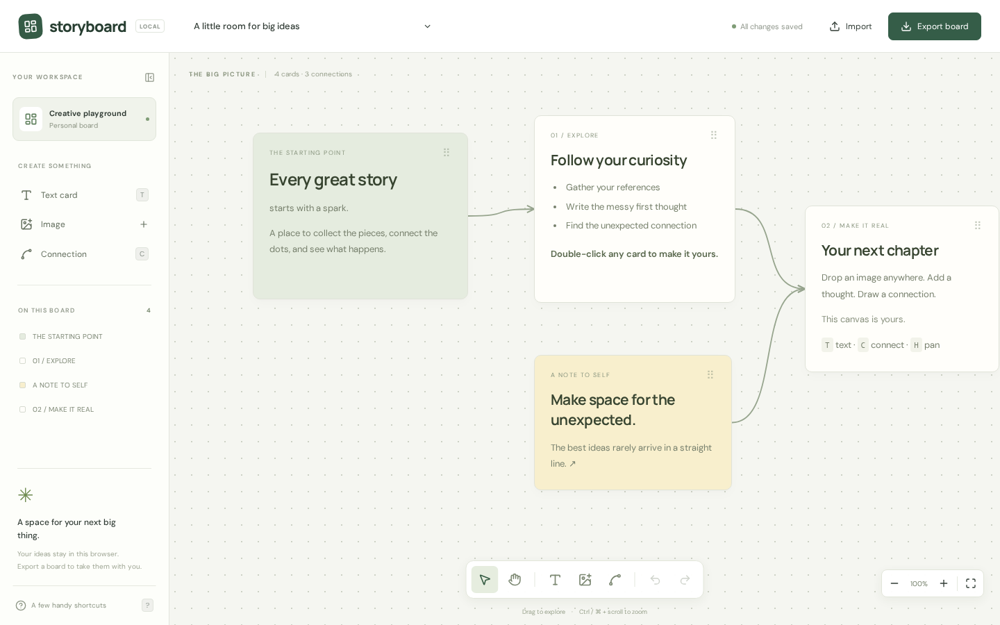

# Storyboard

A quiet space for big ideas. A local-first, infinite canvas for arranging images, writing Markdown, and connecting thoughts with curved arrows. Built with React, TypeScript, and Vite. No account or server required.



## Run locally

Requires Node.js 22.12 or newer and npm.

```sh
npm install
npm run dev
```

Open the local URL printed by Vite (normally http://localhost:5173).

```sh
npm run build       # Type-check and build to dist/
npm run preview     # Serve the production build locally
npm test            # Board validation and geometry tests
npm run format:check # Check source formatting
npx playwright install chromium
npm run test:e2e    # Browser interaction tests
```

Deploy `dist/` to any static host. There is no backend, API key, or environment configuration.

## Make a board

- **Draw:** press `P` or choose the pen in the toolbar. Draw directly on the canvas with a mouse, touch, or stylus. Choose ink color and width above the canvas. Each stroke is an undoable action; press `V` to select and drag a stroke, or Delete to remove it. Drawings autosave and travel with exports. Older board files still import.
- **Text:** add a card from the sidebar, press `T`, or double-click the canvas. Double-click a card to edit Markdown with live preview and formatting buttons. Headings, emphasis, links, lists, tables, and code are supported.
- **Images:** drag PNG, JPEG, GIF, or WebP files onto the canvas, paste from the clipboard, or use the image button. Multiple files are supported, up to 20 MB per image. Images are embedded in exported boards.
- **Arrange:** drag cards; select one to rename, recolor, duplicate, delete, or resize with its bottom-right handle. Images preserve their aspect ratio within their frame.
- **Connect:** press `C`, click a source card, then a destination. Cubic Bézier arrows follow moving cards. Select an arrow and press Delete to remove it.
- **Navigate:** drag the background or use `H` to pan. Hold Space to temporarily pan. Scroll pans; Ctrl/⌘ + scroll zooms around the pointer. `F` fits the board; the percentage button resets zoom.
- **History:** Ctrl/⌘ + Z undoes; Ctrl/⌘ + Shift + Z redoes. Dragging is one history action. Up to 50 board snapshots are retained during the session.
- **Backups:** export a `.storyboard.json` file; import it later or on another device. Import replaces the current board and can be undone.

Press `?` for shortcuts. The initial board is an editable starter, not a separate document.

## Data and privacy

The current board autosaves to IndexedDB after a short debounce. The save indicator reports completion or failure. This is a single-board application; export to keep multiple projects. Clearing site data or switching browsers/origins does not preserve your local board. Export before doing so. History and viewport position are session-only.

Board content and images are not sent to a server. The UI uses system font fallbacks; optional Google Fonts load when online. Markdown is sanitized with DOMPurify; embedded Markdown images are disabled to avoid remote image requests. Imported image cards accept embedded raster data only, and imported structures, IDs, geometry, and connections are validated. Imports are limited to 100 MB, 10,000 cards, and 30,000 connections. These are validation limits, not performance guarantees.

## Architecture and performance

- `src/main.tsx`: canvas interaction, card editor, history, import/export, and UI.
- `src/model.ts`: typed document format, validation, culling, and spline geometry.
- `src/storage.ts`: IndexedDB persistence with transactional writes.
- `src/style.css`: responsive layout and canvas styling.
- `src/model.test.ts`, `tests/board.spec.ts`: model and end-to-end tests.

A single CSS transform pans/zooms the world. Off-screen cards are culled with an overscan margin. Markdown rendering is memoized so panning and dragging do not reparse unchanged text. Nodes are indexed once per document change for connector lookups. Pointer capture keeps drags reliable outside card boundaries; only completed gestures enter history. Images are shared as immutable strings between history snapshots, and saves are debounced.

Connectors are SVG and remain mounted; geometry work is linear in the number of connections. Very large images and dense graphs can still consume significant memory. There is no collaboration, cloud sync, multi-selection, or full touch-pinch gesture support yet. The app is best used in a modern desktop browser; touch dragging and compact layouts are supported.

## Contributing

Use `npm ci` for a reproducible install. Run `npm run build`, `npm test`, and `npm run test:e2e` before opening a pull request. Include a regression test for changes to document validation or canvas interactions. CI runs these checks on pushes and pull requests.

## Support and license

MIT licensed; see [LICENSE](LICENSE). GitHub Sponsors is configured in [.github/FUNDING.yml](.github/FUNDING.yml). The confirmed GitHub Sponsors account is `obhi-d`.
